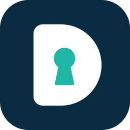

<p align="center">

</p>

<h1 align="center">DT Connect</h1>

<p align="center">
<a href="https://github.com/{{repo}}/releases/latest"></a>
<a href="https://github.com/{{repo}}/releases"></a>
</p>

<div dir="rtl">

<p align="center"><b>اپ رسمی دیتاکرفت</b> برای ویندوز، اندروید، مک و لینوکس<br>فقط با لینک اشتراک‌تان وارد شوید و با یک لمس به سریع‌ترین سرور وصل شوید.</p>

## ⬇️ دانلود — نسخه‌ی {{version}}

| سیستم | دانلود | برای چه کسی |
| --- | --- | --- |
| 🪟 **ویندوز ۱۰ و ۱۱** (۶۴ بیتی) | [**DT-Connect-Setup.exe**]({{base}}/DT-Connect-Setup-{{version}}.exe) | همه‌ی کامپیوترهای ویندوزی |
| 🤖 **اندروید ۵ به بالا** | [**DT-Connect.apk**]({{base}}/DT-Connect-{{version}}-android-universal.apk) | همه‌ی گوشی‌ها و تبلت‌های اندرویدی (یک فایل برای همه) |
| 🍎 **مک** با تراشه‌ی Apple (M1 و جدیدتر) | [**mac-arm64.pkg**]({{base}}/DT-Connect-{{version}}-mac-arm64.pkg) | macOS 12 به بالا |
| 🍎 **مک** اینتل | [mac-x64.pkg]({{base}}/DT-Connect-{{version}}-mac-x64.pkg) | macOS 12 به بالا |
| 🐧 **اوبونتو، دبیان، مینت، Pop!_OS** | [amd64.deb]({{base}}/DT-Connect-{{version}}-linux-amd64.deb) · [arm64.deb]({{base}}/DT-Connect-{{version}}-linux-arm64.deb) | |
| 🐧 **فدورا، RHEL، Rocky، AlmaLinux، openSUSE** | [x86_64.rpm]({{base}}/DT-Connect-{{version}}-linux-x86_64.rpm) · [aarch64.rpm]({{base}}/DT-Connect-{{version}}-linux-aarch64.rpm) | |
| 🐧 **آرچ، مانجارو، EndeavourOS** | [x64.pacman]({{base}}/DT-Connect-{{version}}-linux-x64.pacman) · [aarch64.pacman]({{base}}/DT-Connect-{{version}}-linux-aarch64.pacman) | |
| 📱 **آیفون و آیپد** | — | فعلاً نسخه‌ی iOS نداریم: لینک اشتراک را در **Streisand** یا **Happ** وارد کنید. |

**مک من کدام است؟** در منوی Apple گزینه‌ی **About This Mac** را بزنید: اگر جلوی Chip نوشته Apple M1 (یا M2، M3 و…)، فایل arm64 را بگیرید؛ اگر جلوی Processor نوشته Intel، فایل x64 را.

همه‌ی نسخه‌های قبلی در [صفحه‌ی Releases](https://github.com/{{repo}}/releases) هستند.

## 🛠 نصب

**ویندوز:** فایل را اجرا کنید. اگر ویندوز پیام «Windows protected your PC» داد، روی **More info** و بعد **Run anyway** بزنید (فقط بار اول).

**اندروید:** فایل APK را باز کنید و اجازه‌ی نصب از این منبع را یک بار بدهید. اگر Play Protect هشدار داد، اول **More details** و بعد **Install anyway** را بزنید.

**مک:** فایل pkg را باز کنید. بار اول macOS جلوی آن را می‌گیرد: در **System Settings** بخش **Privacy & Security** را باز کنید و دکمه‌ی **Open Anyway** را بزنید. برای پروتکل OpenVPN روی مک، OpenVPN را با Homebrew نصب کنید.

**لینوکس:** در ترمینال، در پوشه‌ای که فایل را دانلود کرده‌اید:

</div>

```bash
# Ubuntu / Debian / Mint
sudo apt install ./DT-Connect-{{version}}-linux-amd64.deb
# Fedora / RHEL   (openSUSE: sudo zypper install ...)
sudo dnf install ./DT-Connect-{{version}}-linux-x86_64.rpm
# Arch / Manjaro
sudo pacman -U ./DT-Connect-{{version}}-linux-x64.pacman
# macOS, OpenVPN only
brew install openvpn
```

<div dir="rtl">

## 🔑 ورود

پیام تحویل سرویس در ربات [@DataCraftBot](https://t.me/DataCraftBot) یک **کد QR ورود** و یک **لینک ورود** دارد.

- **اندروید:** در صفحه‌ی اول «اسکن کد QR ورود» را بزنید. اگر QR روی همین گوشی است، «انتخاب عکس QR» و عکس را از گالری انتخاب کنید. یا روی لینک ورود بزنید.
- **ویندوز، مک، لینوکس:** روی لینک ورود کلیک کنید تا اپ باز شود و وارد شوید، یا فقط لینک اشتراک را در کادر لینک بچسبانید.

هر پلنی که خریده‌اید با همان اکانت در اپ کار می‌کند. هر دستگاه یکی از جاهای «تعداد دستگاه» اشتراک شما را می‌گیرد.

<!-- section:android -->
## 📸 تصاویر اندروید

{{gallery:android}}

<!-- /section -->
<!-- section:desktop -->
## 🖥 تصاویر ویندوز، مک و لینوکس

{{gallery:desktop}}

<!-- /section -->
## 🛡 دانلود امن

- فقط از **همین صفحه** یا لینکی که ربات می‌فرستد دانلود کنید. فایلی که کسی در گروه یا کانال دیگری فرستاده ممکن است دستکاری شده باشد.
- کنار هر نسخه فایل [SHA256SUMS.txt]({{base}}/SHA256SUMS.txt) هست. عددی که دستور زیر برای فایل شما می‌دهد باید با عدد همان فایل در SHA256SUMS.txt یکی باشد.
- آدرس هیچ سروری داخل خود اپ نیست: سرورها، پروتکل‌ها و اطلاعیه‌ها فقط با لینک اشتراک خودتان می‌آیند.

</div>

```powershell
# Windows (PowerShell)
Get-FileHash .\DT-Connect-Setup-{{version}}.exe -Algorithm SHA256
```

```bash
# Linux
sha256sum DT-Connect-{{version}}-linux-amd64.deb
# macOS
shasum -a 256 DT-Connect-{{version}}-mac-arm64.pkg
```

<div dir="rtl">

## 🔒 حریم خصوصی

اپ برای ورود فقط نام کاربری، شناسه‌ی دستگاه، نام و نسخه‌ی سیستم عامل و نسخه‌ی اپ را می‌فرستد تا سقف دستگاه‌های اشتراک رعایت شود. گزارش خطا (لاگ) فقط وقتی فرستاده می‌شود که خودتان «گزارش مشکل» را بزنید، و رمزها، کلیدها و لینک‌ها پیش از ارسال از آن حذف می‌شوند.

## 💬 پشتیبانی

از داخل ربات [@DataCraftBot](https://t.me/DataCraftBot) یا از «تماس با پشتیبانی» در خود اپ.

</div>

---

### English

DT Connect is DataCraft's VPN app. Sign in with your subscription link alone, or scan the sign-in QR code from [@DataCraftBot](https://t.me/DataCraftBot).

| System | Download |
| --- | --- |
| Windows 10 / 11 (64-bit) | [DT-Connect-Setup-{{version}}.exe]({{base}}/DT-Connect-Setup-{{version}}.exe) |
| Android 5.0+ | [DT-Connect.apk]({{base}}/DT-Connect-{{version}}-android-universal.apk) (one file for every phone and tablet) |
| macOS 12+ | [Apple silicon]({{base}}/DT-Connect-{{version}}-mac-arm64.pkg) · [Intel]({{base}}/DT-Connect-{{version}}-mac-x64.pkg) |
| Debian / Ubuntu | [amd64]({{base}}/DT-Connect-{{version}}-linux-amd64.deb) · [arm64]({{base}}/DT-Connect-{{version}}-linux-arm64.deb) |
| Fedora / RHEL / openSUSE | [x86_64]({{base}}/DT-Connect-{{version}}-linux-x86_64.rpm) · [aarch64]({{base}}/DT-Connect-{{version}}-linux-aarch64.rpm) |
| Arch / Manjaro | [x64]({{base}}/DT-Connect-{{version}}-linux-x64.pacman) · [aarch64]({{base}}/DT-Connect-{{version}}-linux-aarch64.pacman) |
| iPhone / iPad | Not available: use your subscription link in Streisand or Happ. |

Checksums: [SHA256SUMS.txt]({{base}}/SHA256SUMS.txt) · Older versions: [Releases](https://github.com/{{repo}}/releases) · Open-source components: [THIRD-PARTY.md](THIRD-PARTY.md)

<p align="center"><sub>© DataCraft</sub></p>
